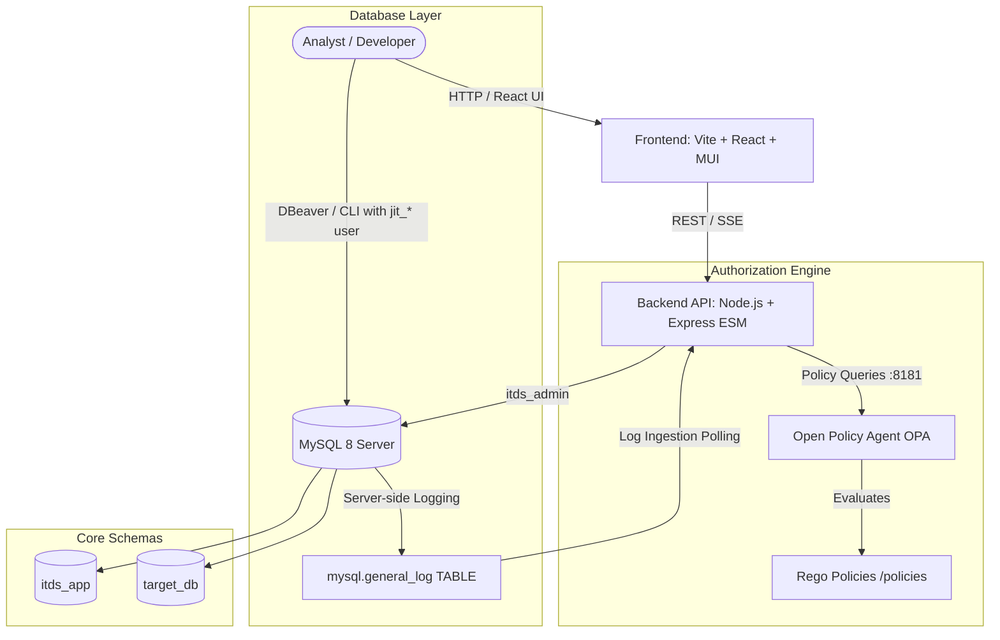

# Insider Threat Detection System (ITDS) - Architecture

## 1. System Overview
The Insider Threat Detection System is an academic prototype designed to provide granular Just-In-Time (JIT) access governance, server-side SQL activity monitoring, policy enforcement via Open Policy Agent (OPA), and explainable risk scoring for organizational databases.



## 2. Core Architectural Pillars

### 2.1 Least Privilege JIT Sessions & User Attribution
- Rather than sharing database accounts or relying on client-reported usernames (e.g. from connection strings or DBeaver), each approved session provisions a dedicated temporary MySQL user:
  ```
  jit_<sessionId>_<rand>
  ```
- The user is provisioned with least-privilege table-level `GRANT`s.
- When the session expires or is revoked, the temp MySQL user is dropped and active connections are terminated with `KILL`.

### 2.2 Server-Side SQL Auditing
- Monitoring does NOT depend on application-level intercepts or proxy intermediaries.
- MySQL server-side logging is enforced:
  - `log_output = 'TABLE'`
  - `general_log = 'ON'`
- The backend polls `mysql.general_log` using a high-water mark, reliably capturing all executed statements and attributing them to the dedicated `jit_*` database user.

### 2.3 Decoupled Policy Governance (OPA & Rego)
- Access request authorization and observed query compliance checks are decoupled from backend code.
- Node.js invokes OPA via REST API endpoints (`/v1/data/...`).
- A fail-closed security default is maintained: any policy evaluation timeout or error triggers an automatic denial.

### 2.4 Explainable Risk Scoring
- All anomaly and threat detections are computed as pure functions yielding:
  - Rule identifier
  - Configurable weight
  - Concrete event IDs (evidence trail)
  - Plain-text reasoning
- Risk scores are composite sums bounded between 0 and 100 with clear breakdown data.

---

## 3. Schemas in MySQL 8

### `itds_app`
Contains application state:
- Users, Roles, Permissions, User Roles
- Resources and Access Profiles
- JIT Access Requests and Active Sessions
- Ingested SQL Events, Policy Violations, Risk Scores, and Alerts

### `target_db`
Represents the organizational database protected by ITDS:
- `departments`: Organizational business units (Engineering, HR, Finance, etc.)
- `employees`: Staff records with job titles and department mappings
- `salaries`: Sensitive payroll data (base salary, bonus, bank account numbers, SSN / tax IDs)
- `customers`: Client accounts, contact information, credit limits
- `orders`: Transactions and order totals
- `payments`: Payment transactions, methods, and reconciliation statuses
