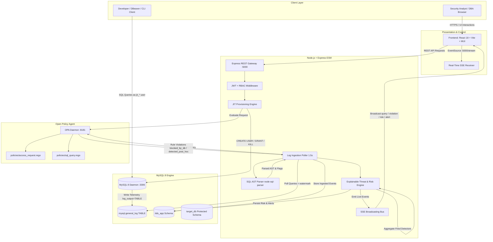
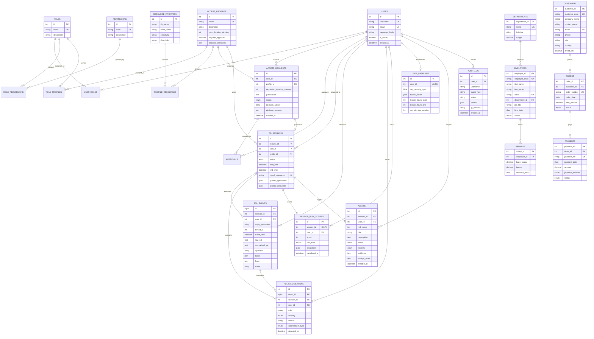

# Insider Threat Detection System (ITDS) - System Architecture

## 1. System Overview

The **Insider Threat Detection System (ITDS)** is an academic prototype designed to provide granular Just-In-Time (JIT) access governance, server-side SQL activity monitoring, policy enforcement via Open Policy Agent (OPA), and explainable risk scoring for organizational databases.



---

## 2. Entity-Relationship (ER) Architecture

The database architecture is split into two isolated schemas:
1. `itds_app`: Controls users, roles, permissions, access requests, JIT sessions, audit trails, and risk telemetry.
2. `target_db`: Represents the protected enterprise database containing organizational datasets.



---

## 3. Core Architectural Subsystems

### 3.1 Just-In-Time (JIT) Credential Lifecycle
1. **Request & Policy Gating**: An analyst or developer requests access to a predefined profile. OPA evaluates the request against `policies/access_request.rego` considering role, sensitivity, time of day, and duration.
2. **Dynamic Provisioning**: Upon approval, the backend connects as `itds_admin` and creates a dedicated MySQL account:
   ```sql
   CREATE USER 'jit_<requestId>_<rand>'@'%' IDENTIFIED BY '<random_pass>';
   GRANT SELECT ON target_db.customers TO 'jit_<requestId>_<rand>'@'%';
   ```
3. **Session Attribution**: The ephemeral username is mapped to `db_sessions.id` and `users.id`.
4. **Revocation & Expiry**: When the session expires or is manually revoked via the console, the backend kills active threads in `information_schema.processlist` and drops the user.

### 3.2 Server-Side SQL Auditing (`mysql.general_log`)
- Monitoring operates independently of client configuration (DBeaver, DataGrip, MySQL CLI, scripts).
- MySQL daemon writes executed statements directly to `mysql.general_log` (`log_output='TABLE'`).
- The backend log poller reads from `mysql.general_log` above a persistent high-water mark (`itds_app.ingest_watermark`), parses queries with `node-sql-parser`, and extracts target tables, AST flags (`select_star`, `has_limit`, `has_where`, `is_ddl`, `is_cross_schema`), and operations.

### 3.3 Decoupled OPA Policy Evaluation
- Ingested queries are sent to OPA via REST API (`/v1/data/itds/sql/evaluate`).
- Evaluates against `policies/sql_query.rego` verifying:
  - Allowed operations (`SELECT`, `INSERT`, `UPDATE`, `DELETE`, `DDL`)
  - Permitted table scopes
  - Session validity and expiry status
  - Bounded read compliance (`LIMIT` clause enforcement on large tables)
- Violations are classified into:
  - **`blocked_by_db`**: Pre-execution physical denials by MySQL engine (`ER_TABLEACCESS_DENIED_ERROR`).
  - **`detected_post_hoc`**: Contextual and semantic violations captured by audit telemetry.

### 3.4 Multi-Detector Risk Engine
Composite risk scoring aggregates six deterministic, pure detector functions:
1. `high_query_velocity` (weight 25): Spikes exceeding 2x the user's historical QPM baseline.
2. `bulk_export` (weight 30): Unbounded `SELECT *` dumps without `LIMIT` or `WHERE`.
3. `off_hours_activity` (weight 20): Queries executed outside the user's regular working hours.
4. `out_of_profile_table` (weight 25): Accessing tables outside the user's typical baseline scope.
5. `rapid_failed_queries` (weight 25): Permission denials and failed probes within a session.
6. `cross_schema_read` (weight 30): Queries spanning multiple schemas or probing system tables (`information_schema`, `mysql`).

Risk score is computed as:
$$\text{Risk Score} = \min\left(100, \sum_{\text{fired}} \text{weight}\right)$$

When Risk Score $\ge 70$, a deduplicated Security Alert is generated with complete explainable evidence trails.

### 3.5 Real-Time Reactive Pipeline (SSE)
- Security consoles connect to `GET /stream?token=<token>`.
- Heartbeat keep-alive every 15 seconds.
- Pushes events asynchronously as they are ingested and evaluated:
  - `query_observed`: Streaming SQL statements with attribution badges.
  - `violation_detected`: Real-time policy violations.
  - `risk_updated`: Dynamic session risk recalibration.
  - `alert_created`: High-severity incident alerts.
